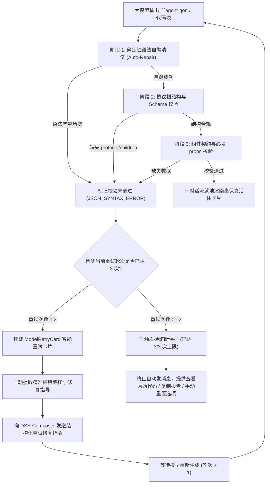

# @civilization/deepseek-genui

Agent GenUI（Generative UI）全功能生成式界面运行时与可视化组件系统面板插件。遵循 [agent-genui-system-design.md](./agent-genui-system-design.md) 工业级架构规范，并深度融合 **DSH Unified UI（统一设计规范 Tokens）**、**React Flow 拓扑画布**、**Mermaid 10.x 离线引擎** 与 **双层宿主隔离保护机制**。

---

## 🛡️ 核心修复与宿主隔离保障体系（Fault Isolation & Zero Crash）

针对此前发生的 `slot entry crashed in 'main'` 以及图片/图表渲染异常波及 DSH 主功能的问题，本次重构完成了底层架构级别的安全加固：

1. **作用域符号完全闭合（Symbol Scope Guarantee）**：
   - 彻底修复 `HeatmapChart` 等图表组件未在 `Renderers` 外部声明导致引用未定义（`ReferenceError`）的问题。所有组件在 `client.js` 工厂闭包中严格先声明后引用。
2. **SafeRendererHost 沙箱执行器 + ComponentErrorBoundary 双层防御屏障**：
   - **第一层（函数执行期防护）**：使用 `SafeRendererHost` 对所有 DSL 节点的 `renderer(...)` 执行过程进行 `try...catch` 拦截。即使输入数据严重畸变、属性为 null 或计算报错，仅局部渲染为行内警示卡片，异常绝不向上抛出。
   - **第二层（React 生命周期防护）**：包裹 `ComponentErrorBoundary`，捕获所有子组件异步加载与生命周期错误，并提供「尝试恢复渲染」按钮。
   - **结果保证**：**任何图表、第三方脚本、媒体资源的加载失败，绝对不会导致 DSH 宿主主窗口（`slot: 'main'`）崩溃或白屏**。
3. **多媒体安全与防抖容器（SafeImage & Media Container）**：
   - **CSP 协议安全校验**：自动放行 `http://`, `https://`, `data:image/` 及本地相对路径，拦截不安全协议。
   - **异步加载与占位防抖**：加载中显示轻量 Spinner 骨架，固定纵横比（Aspect Ratio），防止主面板布局因图片跳动；加载失败优雅降级为重试卡片。
   - **全屏模态预览（Lightbox）**：点击图片即平滑唤起半透明遮罩进行大图审查，点击任意区域平滑关闭。

---

## ⚡ 纯离线静态资产架构 (Offline Media & Asset Architecture)

为保障在银行、专网、保密局域网及无外网（Air-Gap）环境下的 100% 独立稳定运行，本插件实现了全面的静态资产纯离线化：

1. **图形引擎完全离线**：
   - 内置 `vendor/mermaid.min.js`（3.3MB），由 `index.js` 原生托管静态路由服务，不依赖任何公共 CDN。
2. **多媒体演示矢量化（0ms 加载）**：
   - 多媒体演示图片全面移除对外部图床（如 Unsplash）的依赖；
   - 采用纯本地矢量 SVG 生成引擎（`getOfflineDemoImage`），生成的 `data:image/svg+xml` 零网络请求、0ms 极速加载、在 Retina 4K 屏幕上自适应高清无损缩放。

---

## 🎨 7 大核心维度组件系统矩阵

针对 `@civilization/deepseek-genui` 工业级场景，全面对齐 7 大维度标准体系：

| 维度 | 组件覆盖 | 核心特性说明 |
| :--- | :--- | :--- |
| **1. 基础展示** | `Text`, `Markdown`, `List`, `Badge`, `Tabs`, `Accordion`, `Tooltip`, `Popover` | 原生 Markdown 解析排版、状态角标胶囊（成功/警告/危险）、抽屉式平滑折叠面板（Accordion）。 |
| **2. 布局容器** | `Card`, `Grid`, `Stack`, `Split` (分栏), `Container` (嵌套容器) | 响应式多列网格、弹性堆叠（水平/垂直）、双列分栏对照，完美自适应窗口拉伸。 |
| **3. 交互控件** | `Button`, `Input`, `Select`, `Checkbox`, `Radio`, `Switch`, `Slider`, `DatePicker` | 全量接入 DSH 控件规范，受控双向绑定；**滑块支持拖动手势 60fps 平滑渲染与松手单次 Commit 提交（彻底避免高频滑动刷屏）**，文本输入配备 400ms 防抖与回车即时提交，事件统一经由 `agent-genui-event` 分发上报。 |
| **4. 数据可视化** | `Line`, `Area`, `Bar`, `Donut`, `Pie`, `Radar`, `Scatter`, `Heatmap`, `Funnel`, `Gauge` | **全量配备笛卡尔坐标系**：X/Y 轴基线、数值网格、刻度标签、单位显示、悬浮数值 Tooltip 与图例色阶。 |
| **5. 图形可视化** | `Flowchart`, `Sequence`, `ER`, `StateMachine`, `Architecture`, `Mindmap / Network` | **React Flow 画布 & Mermaid 10.x 双引擎**：架构拓扑常驻自由切换，时序图真实生命线与定向箭头。 |
| **6. 开发者 UI** | `Code`, `Diff Viewer`, `JSON Viewer`, `Tree View`, `Terminal` | 行号高亮与复制、Git 级版本对比（增删着色）、交互式 JSON 树折叠、文件目录树、仿真控制台日志。 |
| **7. 多媒体体系** | `SafeImage`, `Image Gallery`, `Audio Player`, `Video Player` | 协议安全校验、加载失败优雅兜底、点击全屏大图预览、多图缩略图画廊、仿声波动态音频播报。 |
| **+ Agent 决策** | `Comparison`, `Task Plan`, `Metric`, `Callout` | 方案横向多维对比（支持单选 + 确认采纳提交）、多阶段分布式任务编排执行流水线。 |

---

## 🚀 1.0.4 模型输入多层校验与 3 次智能有界重试升级 (Model Input Validation & Bounded Retry)

本次更新针对大模型生成数据无法解析或格式不合规的场景，完成了端到端的输入校验与智能修复闭环加固：

1. **轻量确定性语法自愈（Deterministic Auto-Repair）**：
   - 内置容错清洗层，自动处理尾随多余逗号（`{"a": 1,}`）、单双引号混用、Python 风格布尔常量（`True`/`False`/`None`）、注释以及未闭合的大括号；
   - 能够自愈的轻微语法问题直接就地正常渲染，0 延迟、不浪费模型重试轮次与上下文。
2. **多层协议结构与组件契约校验（Multi-Layer Validation）**：
   - 严格断言 Object 根结构、`protocol: "agent-genui"`、`version: "1.0"`、ID 唯一性与组件必填属性；
   - 针对 `chart`（必须包含 `series`/`data`）、`diagram`（必须包含拓扑描述）等核心组件进行参数深度校验，缺失时精确定位具体错误路径。
3. **3 次有界智能重试与熔断保护（Bounded 3-Attempt Retry）**：
   - 当模型输入数据系统无法解析时，挂载高保真交互重试卡片（`ModelRetryCard`），自动向 DSH Composer 注入精准报错诊断与格式规范指令，指导模型定向修正重试；
   - **严格限定最多重试 3 次**：连续 3 次均未通过时触发硬熔断，停止自动发送消息，彻底杜绝死循环无限刷屏消耗用户 Token；
   - 提供「立即让模型重试」、「暂停自动重试倒计时」、「复制修复指令」、「展开查看原始输出代码」与「重置并重新发起」等全套人工接管控制项。
4. **运行时设置面板可控配置**：
   - 设置中新增模型输入校验开关、重试上限（1~5 次，默认 3 次）与自动重试倒计时（默认 1500ms）调节。

---

## 🚀 1.0.3 UI 体验与工业级组件细节深度升级

本次更新针对组件库全量进行了精细化 UX 增强与硬编码解耦：

1. **数据表格（Table）增强**：
   - **表头吸顶（Sticky Header）**：表头在纵向滚动时自动吸顶固化（`position: sticky; top: 0`），告别多行数据滚出视口后看不清表头的困扰；
   - **高度保护与条数统计**：支持 `maxHeight` 属性（数据量超大时自适应滚动），底部增设数据统计条（显示当前排序规则与总记录数）；
   - **空状态友好兜底**：无数据时居中展示轻量图标与友好文案。
2. **可视化图表（Chart）防重叠与交互升级**：
   - **X 轴文本抽样防挤占**：当采样点超过 8 个时，自动采取等距步长抽样展示关键标签（首尾必显），彻底解决高密度数据下文本重叠模糊的问题；
   - **原生悬浮 Tooltip 气泡**：在折线点、柱状条、散点、环形切片上全量接入 `<title>` 原生提示，鼠标悬停即刻透视详细数值与单位；
   - **散点图自适应量程**：X/Y 轴范围自动根据实际数据极值自适应缩放计算，去除写死坐标量程；
   - **面积图渐变 ID 隔离**：生成动态唯一 ID，避免多图同屏渐变串色；
   - **环形图调色板扩充**：色彩池全面扩充至 12 色，满足多维度分类切片需求。
3. **关键指标（Metric）红绿语义反转**：
   - 增加 `invertColor: true` / `goodDirection: 'down'` 支持。在服务器延迟下降、错误率下降等正向改善场景下，下降趋势自动标为绿色，符合业务直觉。
4. **任务链进展（Task Plan）精细化**：
   - 支持展示每步执行耗时胶囊标签（`duration`，如 `"1.2s"`）以及辅助说明文本（`description`）。
5. **表单控件（Form）校验提示**：
   - 支持字段必填红星标识（`required: true`）与字段下方行内错误文本（`error`），进一步夯实人机协同闭环。

---

## 💬 聊天对话流就地组件替换（Chat In-Place Live Component Rendering）

为了让用户在与大模型日常对话时直接获得直观、高保真的可视化与交互体验，插件现已实现 **聊天对话流内原生代码块自动替换** 能力：

1. **彻底跳脱外层代码块包裹（Un-nest from Codeblock Frame）**：
   - 自动向上穿透并隐藏宿主包含 `[data-code-block-banner]` 的外层代码块卡片容器，彻底消除顶部多余的「代码块」标题栏、缩略栏与重复的复制按钮；
   - 将 GenUI 卡片作为一等公民（First-Class Native Card）直接嵌入对话流中，对齐 ChatGPT 原生可视化组件的无边沉浸式排版体验。
2. **流式高保真骨架屏（Shimmer Skeleton Screen Loading）**：
   - 在大模型流式吐字未闭合 JSON 期间，直接渲染带微光波纹动画（Shimmer）的高保真骨架屏（`GenuiSkeletonCard`）；
   - 包含流式呼吸微光指示灯、3 列 KPI 指标卡片占位与波形图表脉冲骨架，完全告别突兀白屏或干瘪文本，一旦 JSON 闭合立即丝滑淡入交互卡片。
3. **第一公民一体化卡片容器与语义化分级排版（Unified Container & Semantic Component Taxonomy）**：
   - 整条 GenUI 回复消息作为一个**单一、高保真的一体化卡片容器**呈现，内部按清晰的组件语义进行分级展示：
     - **纯画质/图形/图表（坚决不套卡 · Frameless Visual Canvas）**：
       - 包括 `chart`（折线图、面积图、柱状图、环形图、仪表盘、散点图、热力图）、`diagram`（Mermaid 拓扑、React Flow 架构泳道、时序交互流、业务流程图、ER 模型）、`image` / `imageGallery`、`video`、`audio`；
       - 图形本身已具备坐标轴、图例、矢量节点或播放控制器等完整视觉边界，彻底移除内部所有嵌套的灰色边框与卡片壳，以平铺画布形式无缝融入卡片。
     - **数据概览 / 关键指标（KPI 响应式微型磁贴 · Anti-Billboard Grid）**：
       - 包括 `metric`；
       - 运行时在 `GenuiCardTree` 树构建期自动检测连续的 `metric` 节点，智能横向聚合成自适应 KPI 磁贴行（`.dgen-metric-kpi-grid`，2~4 列响应式排布）；单个指标智能限宽收敛，彻底杜绝孤立、纵向撑满全屏的粗暴“大字报”现象。
     - **业务实体卡片（保留优雅的结构化卡片 · Intrinsic Business Entity）**：
       - 包括 `card`（业务信息卡）、`comparison`（方案选型决策推荐卡）、`diffViewer`（Git 级代码增删对比）、`form`（交互式输入提交表单）、`taskPlan`（Agent 任务流水线）；
       - 拥有明确的数据封闭性与决策交互属性，保留精致的一级业务卡片轮廓与悬浮微光。
     - **内容表面与文本（自然流式排版 · Content Surface）**：
       - 包括 `table`（自包含可横向滚动数据表，绝无二度套壳）、`code`（DSH 统一代码块带行号与一键复制）、`markdown` / `text`（标准排版正文）；
     - 各分块在垂直堆叠布局下由极细质感分割线（`1px solid var(--dsw-alias-border-l4)`）自然区隔，对齐 ChatGPT / Claude 工业级顶尖排版质感。
4. **分布式系统架构图拓扑精度与响应式重构（Architecture Diagram 2.0）**：
   - **真实精确的 DAG 有向无环图**：默认采用 Mermaid 10.x 规范拓扑，实现「客户端层（Web/App/DSH）流量收敛汇聚 -> 网关层（WAF/Kong/OAuth2）过滤鉴权 -> 服务层（微服务/Agent）扇出分发 -> 存储层（Redis/PG/向量库）定向读写」，数据库节点使用标准圆柱体；
   - **弹性响应式自适应**：彻底去除固定 960px 限制，自适应窗口宽度，彻底解决移动端与窄屏侧边栏下右侧被截断的问题；
   - **杜绝虚假指标**：彻底移除硬编码的伪造延迟（如死循环计算的 `18ms/26ms`）与硬编码实例数，以真实的系统架构角色与状态标签呈现；
   - **交互式泳道画布（Canvas）**：提供基于动态平滑三次贝塞尔曲线（Cubic Bezier Curves）的连线引擎，支持鼠标悬停节点动态高亮输入/输出链路。
5. **宿主隔离防护**：
   - 聊天内渲染同样享有 `SafeRendererHost` 与 `ComponentErrorBoundary`，任一组件语法异常或未知类型均局部优雅降级，绝对保证主聊天窗口与会话流稳定运行。

---

## 🤖 面向大模型的 System Prompt 指令套件 (LLM System Prompt Kit)

在让大模型（如 DeepSeek-V3 / DeepSeek-R1 / Qwen 等）与 GenUI 协同交互时，建议在 Agent 的 System Prompt 中注入以下标准化规范：

### 1. Markdown 代码块输出模式（推荐日常对话使用）
```markdown
【GenUI 输出指令】
你是一名具备全栈与系统架构设计能力的专家级 AI Agent。
当用户的提问涉及：
- 系统架构、调用链路、时序交互时：优先使用 diagram (architecture / sequence / flowchart)；
- 方案选型与技术对比时：使用 comparison 组件，并明确标出 recommendedOptionId；
- 性能与业务监控时：使用带有笛卡尔坐标系的 chart (line / bar / scatter / heatmap)；
- 复杂数据结构时：使用 jsonViewer 或 treeView。

输出时，请在正文中给出简明扼要的结论，紧接着输出包裹在 ```genui 代码块中的标准 JSON DSL：

```genui
{
  "protocol": "agent-genui",
  "version": "1.0",
  "id": "ui_cluster_report",
  "title": "生产集群全景分析",
  "layout": { "type": "stack", "gap": "md" },
  "children": [
    {
      "id": "m1",
      "type": "metric",
      "props": { "title": "当前 QPS 吞吐", "value": "12,480", "unit": "req/s", "change": "+18.2%", "changeType": "up" }
    },
    {
      "id": "c1",
      "type": "chart",
      "props": {
        "chartType": "line",
        "title": "24小时 QPS 走势",
        "series": [{ "label": "00:00", "value": 240 }, { "label": "12:00", "value": 890 }]
      }
    }
  ]
}
```
```

### 2. Tool Calling (Function Calling) 声明 Schema
在以工具调用（Tools / Function Call）驱动的场景下，注册如下工具定义：
```json
{
  "name": "render_genui",
  "description": "向客户端宿主界面渲染高保真、可交互的 GenUI 可视化卡片",
  "parameters": {
    "type": "object",
    "required": ["dsl"],
    "properties": {
      "dsl": {
        "type": "object",
        "required": ["protocol", "version", "id", "children"],
        "properties": {
          "protocol": { "type": "string", "enum": ["agent-genui"] },
          "version": { "type": "string", "enum": ["1.0"] },
          "id": { "type": "string" },
          "title": { "type": "string" },
          "layout": {
            "type": "object",
            "properties": {
              "type": { "type": "string", "enum": ["stack", "grid", "split", "row"] },
              "gap": { "type": "string", "enum": ["sm", "md", "lg"] }
            }
          },
          "children": {
            "type": "array",
            "items": {
              "type": "object",
              "required": ["id", "type", "props"],
              "properties": {
                "id": { "type": "string" },
                "type": { "type": "string" },
                "props": { "type": "object" }
              }
            }
          }
        }
      }
    }
  }
}
```

---

## 🛡️ 模型输入校验与 3 次智能有界重试机制 (Model Input Validation & Bounded 3-Attempt Retry)

针对大模型在长上下文生成或复杂结构输出时偶发的 **JSON 语法残缺、未闭合、尾随逗号或缺失关键属性** 问题，插件全面实现了 **模型输入多层校验** 与 **3 次有界智能重试闭环**：



### 1. 深度多层校验流水线（Multi-Layer Validation Pipeline）
- **轻量确定性自愈清洗**：
  - 在宣布解析失败前，先通过 `tryRepairJson` 自动处理尾随逗号（`{"a": 1,}`）、单双引号混用、Python 布尔常量（`True`/`False`/`None`）、注释以及未闭合的大括号；
  - 能够自愈的轻微问题直接正常渲染，**完全零延迟、不浪费模型重试轮次与上下文**。
- **协议根结构校验**：
  - 校验是否为合法 Object，校验 `protocol === "agent-genui"`、`version === "1.0"`、全局唯一 `id`、根 `layout` 容器以及 `children` 数组。
- **组件契约与关键属性校验**：
  - 覆盖全量 30+ 种注册组件；
  - 针对复杂组件执行契约断言：例如 `chart` 必须包含 `series` 或 `data`，`diagram` 必须包含拓扑或图形描述，缺失时立即精确定位到具体子节点。

### 2. 3 次有界重试闭环（Bounded 3-Attempt Retry）
- **严格 3 次限制（可以重试三次）**：
  - **第 1 次重试**：告知模型具体解析错误路径并要求重新生成完整代码块；
  - **第 2 次重试**：附带常见语法防范与必填属性约束再次提醒；
  - **第 3 次重试**：最后一次修复机会，提示若依然失败将熔断降级；
  - **超过 3 次熔断**：触发硬熔断保护，停止自动发送消息，**彻底避免死循环无限刷屏消耗用户 Token**。
- **高保真交互重试卡片（`ModelRetryCard`）**：
  - **重试进度胶囊**：直观展示当前重试轮次（如 `第 1/3 次重试机会`）；
  - **精准报错定位**：高亮显示具体的解析异常信息与问题路径（如 `children[0].props.series`）；
  - **倒计时自动重发**：默认 1.5 秒缓冲倒计时条，既给用户查看反应时间，又无需每次手动点击；
  - **丰富的人机接管选项**：提供「立即让模型重试」、「暂停自动重试」、「复制修复指令」、「查看/展开原始输出数据」与「在 GenUI 工作台打开调试」；
  - **熔断兜底状态**：当达到 3 次上限后，卡片自动切换为熔断告警状态，支持一键「重置并重新发起」或展开原始数据人工排查。

### 3. 可控配置项（Settings Panel）
在 GenUI 设置面板中可根据实际使用偏好自由配置：
- **模型输入校验与自动重试**：总开关，默认开启；
- **模型有界重试上限**：支持 1~5 次调节，**默认值为 3 次**；
- **自动重试倒计时**：支持设置 0~10000ms（设为 0 即为仅手动点击重试，默认 1500ms）。

---

## 🧠 DSH Agent Skill 智能认知接入（Native Agent Skill Registration）

本插件内置了符合 DSH 官方规范的 Agent Skill 认知包（`skills/agent-genui/SKILL.md`）：
1. **自动注册进 DSH Agent 认知库**：插件在宿主加载时通过 `ctx.skills.register` 自动将 `agent-genui` 协议规范与 7 大维度组件模板注入 Agent 的认知系统上下文。
2. **免去工作区检索（No Grep）**：当用户在对话中提到「使用 agent-genui 协议生成卡片」时，Agent 能够瞬间识别出卡片协议与 JSON DSL 规范，直接输出标准的 ````agent-genui` 活体卡片，无需在磁盘中执行 `grep` 搜索。

---

## 📦 插件发布与安装部署指南 (Publishing & Deployment)

本项目严格对齐标准 Cordis / DSH 插件规范。

### 1. 本地语法与代码完整性校验
在提交或打包前，执行内置校验脚本：
```powershell
npm run verify
```
输出说明：`node --check client.js && node --check index.js` 会对入口文件进行 AST 严格语法检查。

### 2. 打包生成插件捆绑包（.tgz）
```powershell
npm run pack
```
将在当前目录生成 `civilization-deepseek-genui-1.0.0.tgz`，已包含完整的離线 Mermaid 运行时及本地静态资源。

### 3. 在 DSH 宿主中安装与启用
* **开发模式安装（目录软链）**：
  ```powershell
  plugin_manager action=install_bundle target="d:\project\dsh-plugins\deepseek-genui"
  ```
* **生产模式安装（压缩包分发）**：
  ```powershell
  plugin_manager action=install_bundle target="d:\project\dsh-plugins\deepseek-genui\civilization-deepseek-genui-1.0.0.tgz"
  ```
* 安装后刷新 DSH 宿主窗口，左侧边栏即刻出现 GenUI 图标与面板。

---

## 🗂️ 目录与核心文件说明

| 文件/目录 | 职责与技术实现 |
| :--- | :--- |
| `client.js` | 插件核心前端运行时：包含 DSL 校验器、Deterministic 自动修复引擎、7 大维度全量渲染器、SafeRendererHost 沙箱、Mermaid 离线加载器、聊天对话流就地组件渲染与 Sub-tabs 实时预览台。 |
| `index.js` | 宿主端入口：注册 `agent-genui` Agent Skill 认知协议，托管离线 Mermaid 静态资源服务（无需联网）。 |
| `skills/agent-genui/SKILL.md` | DSH Agent 认知规范与组件模板：让大模型天然理解 `agent-genui` 协议与 7 大维度组件的 JSON 生成规范。 |
| `vendor/mermaid.min.js` | 本地内嵌的 Mermaid 10.9.1 官方完整渲染引擎包（3.3MB），彻底摆脱对 CDN 的依赖。 |
| `agent-genui-system-design.md` | Agent GenUI Runtime 完整系统架构规范与数据协议技术方案文档。 |
| `cordis.patch.yml` | 插件装载补丁配置，注册 `deepseek-genui` 面板项。 |
| `package.json` | 模块声明清单（v1.0.0 正式版），配置发布文件白名单与校验脚本。 |
| `locale/` | 国际化支持字典（`zh.json`, `en.json`）。 |
